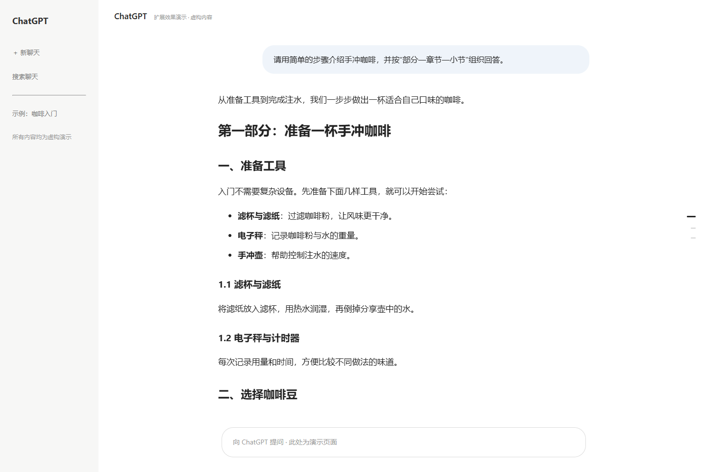
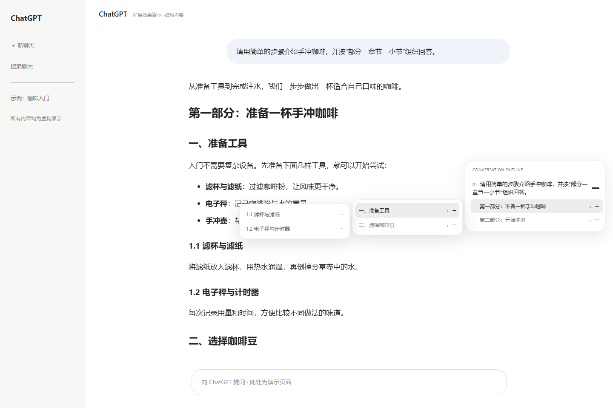
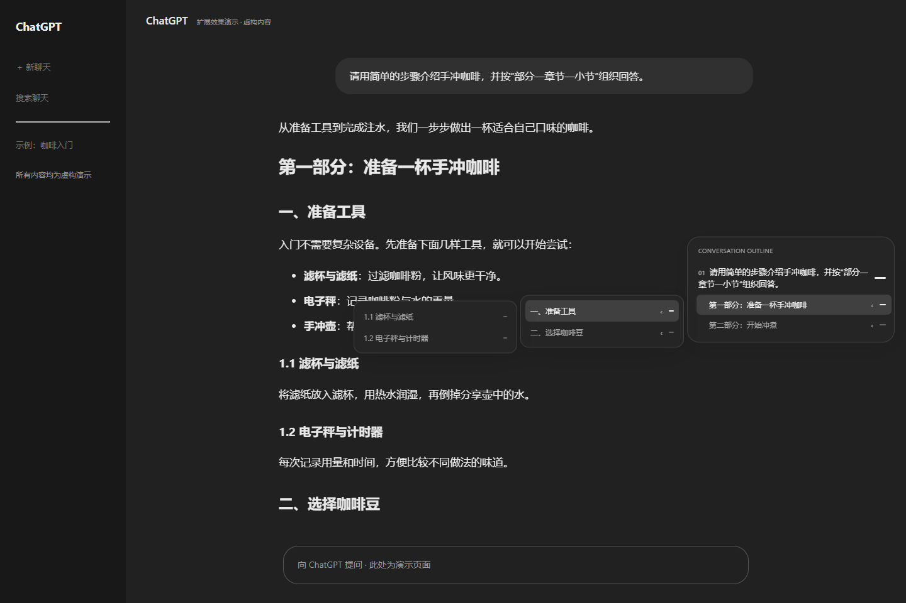

# ChatGPT Outline · 横杠目录

为 ChatGPT 网页添加一个安静的右侧目录：平时只显示横杠，悬停预览提问与标题，点击跳转到相应内容。支持 Edge，也可在 Chrome 中以解压扩展的方式加载。

**当前版本：1.0.1 · Manifest V3 · 本地运行 · 无第三方运行依赖**

[下载安装包](chatgpt-outline-v1.0.1.zip?raw=true) · [隐私说明](docs/PRIVACY.md) · [更新记录](docs/CHANGELOG.md)

## 示例效果

以下图片使用虚构的咖啡教程和演示页面生成，不包含真实账号、个人对话或浏览器标签页。

### 平时：只有横杠

长横杠对应历史提问，短横杠对应回答中的一级标题。阅读位置会自动高亮。



### 悬停：逐级展开到三级

悬停一级标题，只显示它的二级标题；再悬停某个二级标题，只显示它的三级标题。切换分支时，之前的分支自动收起。



### 深色模式



## 安装到 Microsoft Edge

1. 点击上方「下载安装包」，保存 ZIP 文件。
2. 解压 ZIP，将 `chatgpt-outline` 文件夹放到准备长期保留的位置。
3. 在 Edge 地址栏输入 `edge://extensions`。
4. 开启「开发人员模式」。
5. 点击「加载解压缩的扩展」，选择**直接包含 `manifest.json` 的文件夹**。
6. 打开或刷新 `https://chatgpt.com`，进入一段已有聊天。

也可以使用 GitHub 的 **Code → Download ZIP** 下载整个仓库。解压后进入仓库目录，选择其中的 **`chatgpt-outline/` 子文件夹**，不要选择仓库根目录。该子文件夹直接包含 `manifest.json`。

> 扩展尚未发布到扩展商店，当前使用本地加载方式安装。不能直接选择 ZIP 文件；安装后请保留已加载的文件夹。

## 安装到 Google Chrome

步骤相同，将扩展管理页换成 `chrome://extensions`，开启「开发者模式」后选择「加载已解压的扩展程序」，再刷新 ChatGPT。

无需 API Key、额外账号、付费服务或构建命令。Edge 的本地加载步骤参见 [Microsoft 官方说明](https://learn.microsoft.com/en-us/microsoft-edge/extensions/getting-started/extension-sideloading)。

## 使用方法

| 操作 | 效果 |
| --- | --- |
| 悬停右侧横杠 | 展开提问与一级标题的文字预览 |
| 悬停一级标题 | 显示该标题的二级标题 |
| 悬停二级标题 | 显示该标题的三级标题 |
| 点击提问 | 跳到这条历史提问的位置 |
| 点击任意标题 | 跳到对应回答段落 |
| 移出目录 | 收起预览和所有子目录 |
| 滚动页面 | 自动更新位置高亮 |

- 默认只显示提问与一级标题横杠，四级及以上不进入目录。
- 预览默认最多 80 个字符，过长时省略，最多显示两行。
- 新增提问、流式生成回答和切换聊天时自动更新。
- 目录太长时可在目录内滚动。
- 键盘：Tab 进入，上下键在同级移动，右键进入下一级，左键返回上一级，Enter 跳转，Escape 全部收起。

## 标题如何分层

优先使用明确的编号结构，减少 ChatGPT 回答混用 Markdown 标题层级时出现的错层。

```text
第一部分：咖啡入门             一级
  一、准备工具                 二级
    1.1 滤杯与滤纸             三级
    1.2 电子秤                 三级
  二、开始冲煮                 二级
    2.1 水温与比例             三级
```

- 有「第一部分、第二部分」时：部分为一级，「一、二、三……」为二级，所属数字小节为三级。
- 没有「部分」总标题时：「一、二、三……」为一级，下属小节继续向下分层。
- 没有明确编号的标题，参考网页标签和前面已经确定的层级。
- 也识别独立短段落中的中文编号标题及加粗数字编号标题。
- 普通段落必须在编号后包含实际标题内容；解释中的「第一部分：」「第二部分：」等空标签不会进入目录。
- 代码块、引用、表格和普通列表中的段落不会被当成子标题。

标题识别属于启发式判断；格式非常不规则的回答仍可能需要适配。

## 设置

点击浏览器工具栏中的扩展图标打开设置，设置自动保存并立即生效。设置页面目前为英文。

| 设置 | 作用 |
| --- | --- |
| Show outline | 开启或隐藏目录 |
| Include answer headings | 是否包含回答标题 |
| Smooth scrolling | 是否平滑滚动 |
| Preview length | 预览最多 30～160 个字符 |
| Distance from right edge | 距右边缘 8～120 像素 |

## 更新扩展

1. 下载新版，解压并覆盖原扩展文件夹中的文件。
2. 打开 `edge://extensions` 或 `chrome://extensions`。
3. 在扩展卡片上点击「重新加载」。
4. 回到 ChatGPT，刷新网页。

## 常见问题

**安装后没有目录？**

刷新安装前已经打开的 ChatGPT 标签页，确认扩展开关和 Show outline 均已开启，并打开一段有已发送提问的聊天。空白新聊天不会显示目录。

**更早的提问没有出现？**

扩展只索引当前页面已经加载并渲染的消息。先向上滚动，让网页加载更早消息。

**目录被网页面板挡住？**

在设置中增大 Distance from right edge。

**网页更新后识别失效？**

ChatGPT 的网页结构可能改变，需要调整 `chatgpt-outline/outline-core.js` 中的消息选择器。当前同时兼容 `data-message-author-role` 和 `data-conversation-role` 两种结构。

## 隐私与权限

扩展只在 `https://chatgpt.com/*` 和旧域名 `https://chat.openai.com/*` 上运行。消息正文只在当前页面内存中用于生成目录，不上传、不持久保存；仅将设置写入 `chrome.storage.local`。没有后台服务、遥测、远程代码、第三方请求或外部 API。

唯一显式权限是 `storage`。内容脚本的站点匹配规则限定为上述两个域名。详见 [PRIVACY.md](docs/PRIVACY.md)。

## 仓库结构

```text
.
├── chatgpt-outline/               浏览器扩展源码，加载此文件夹
│   ├── manifest.json
│   ├── outline-core.js
│   ├── content.js
│   ├── popup.html
│   ├── popup.css
│   ├── popup.js
│   └── icons/
├── docs/
│   ├── images/                    虚构内容的效果示例图
│   ├── PRIVACY.md
│   └── CHANGELOG.md
├── tests/                        编号标题识别的回归测试
├── chatgpt-outline-v1.0.1.zip      可直接解压安装的扩展包
├── README.md
├── .gitignore
└── .gitattributes
```

`outline-core.js` 负责消息提取、编号识别与分层；`content.js` 负责目录界面和跳转；`popup.*` 为设置页面。浏览器直接加载 `chatgpt-outline/` 即可运行，无需构建步骤。

开发时可使用 Node.js 运行 `node --test tests/numbered-headings.test.cjs`，检查编号识别与分层规则；安装和使用扩展不需要 Node.js。

项目不是 OpenAI 的官方产品，与 OpenAI 无隶属关系。
